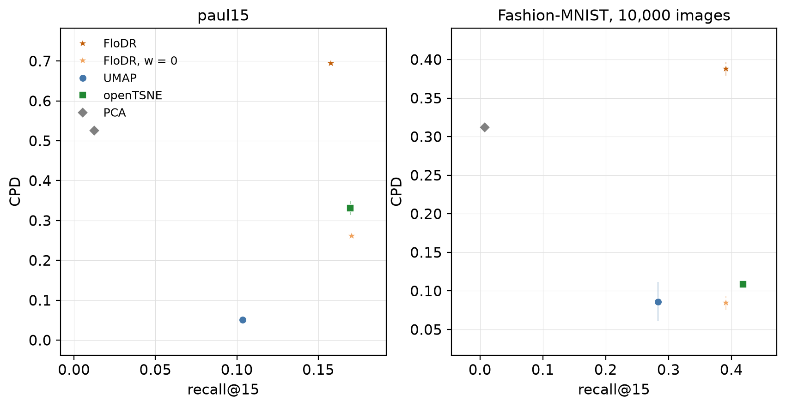

```bash
pip install "flodr[paper]"
python examples/benchmark.py
```

[`examples/benchmark.py`](https://github.com/daenuprobst/flodr/blob/main/examples/benchmark.py) fits FloDR,
FloDR without the distance order (`w=0`), UMAP, openTSNE and PCA to two data sets, three seeds each: the 2,730 bone
marrow cells of paul15 and 10,000 Fashion-MNIST images, both as 50 standardised principal components. It scores each
map by the share of the 15 nearest input neighbours of a point that stay among its 15 nearest on the map (recall@15,
local structure) and by the rank correlation of input and map distances over 500,000 random pairs (CPD, global
structure). It takes about seven minutes with a GPU.



FloDR keeps the most global structure on both: CPD 0.70 on paul15, against 0.33 for openTSNE and 0.05 for UMAP, and
0.39 on Fashion-MNIST, against 0.11 and 0.09. Its recall is within 0.03 of the best, openTSNE (0.419 against 0.391 on
Fashion-MNIST). Without the distance order its CPD falls to that of the neighbour methods (0.26 and 0.08), so the gain
comes from the term weighted by `w`. PCA keeps distances but loses neighbourhoods.

## The script

```python source
examples/benchmark.py
```
