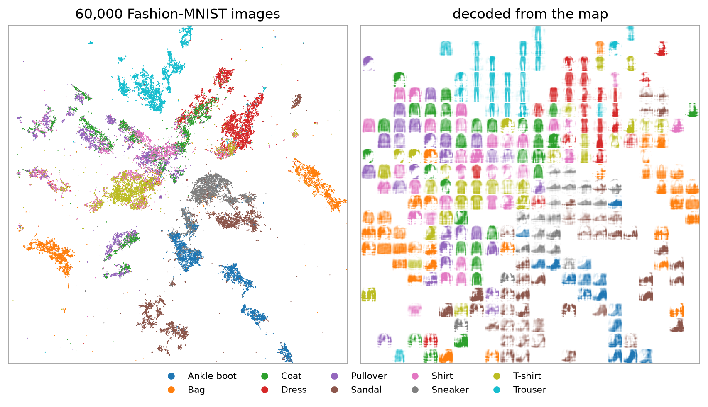
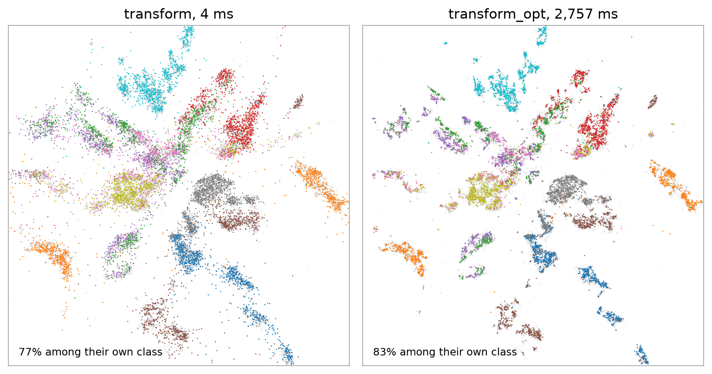
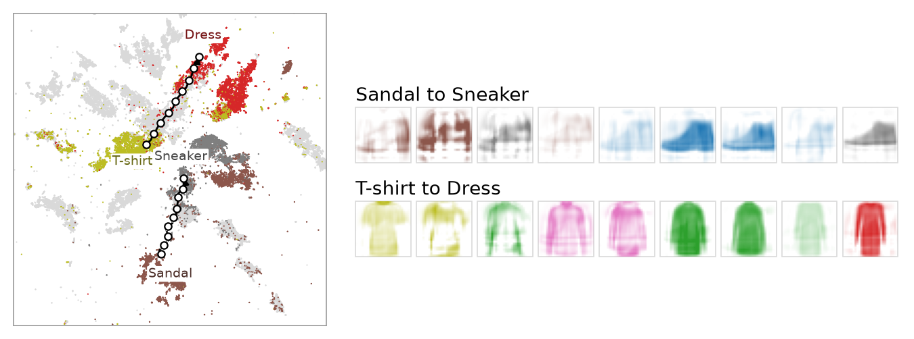
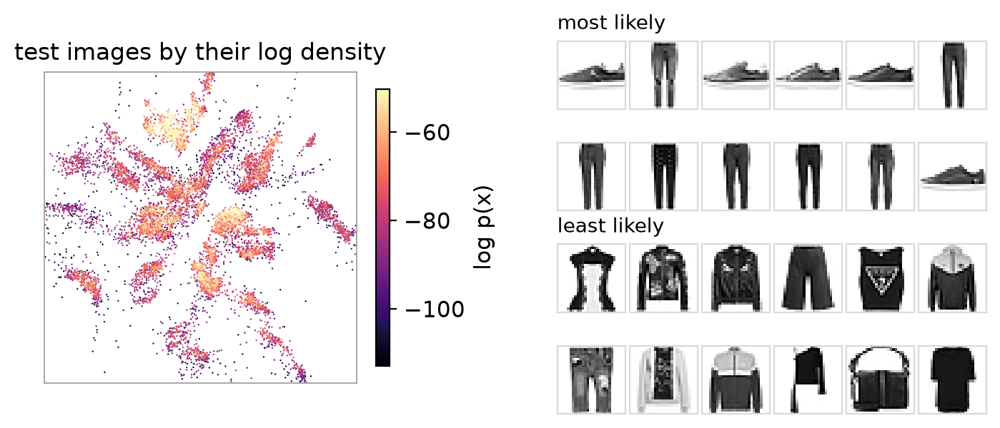

```bash
python examples/fashion_mnist.py
```

[`examples/fashion_mnist.py`](https://github.com/daenuprobst/flodr/blob/main/examples/fashion_mnist.py) fits FloDR
to the 60,000 Fashion-MNIST training images, as 50 standardised principal components of the pixels, and treats the
10,000 test images as new points. It needs only FloDR, downloads the images from OpenML on the first run and takes
about four minutes with a GPU.

```
transform: 10000 images in 4 ms, 76.8% agree
transform_opt: 10000 images in 2757 ms, 82.7% agree
log density median -77.1, coverage: certified
```



The map, and images decoded on a grid over it with the residual of the training images nearest each grid point
([the inverse](../guide/inverse.md)). Each image takes the colour of the class nearest it.



The test images placed by `transform` and by `transform_opt` ([new points](../guide/new-points.md)).



Walks between the densest points of two classes, decoded at nine steps, faded where no training image is near.



The test images by their log density, and the most and the least likely ([density](../guide/density.md)).

## The script

```python source
examples/fashion_mnist.py
```
