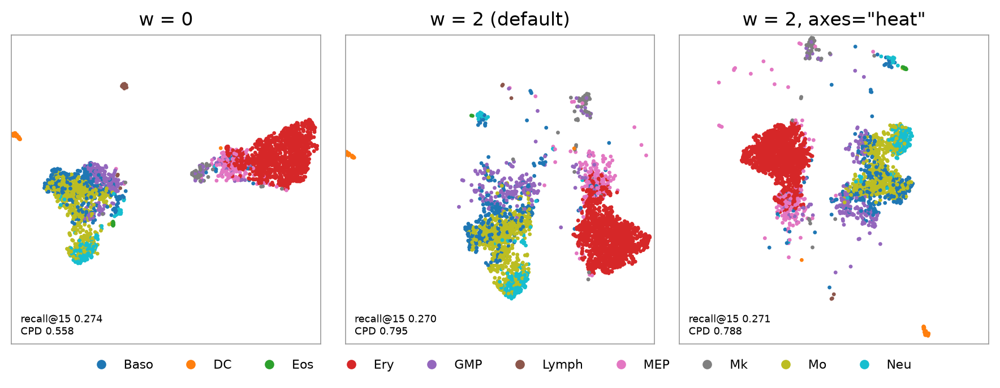
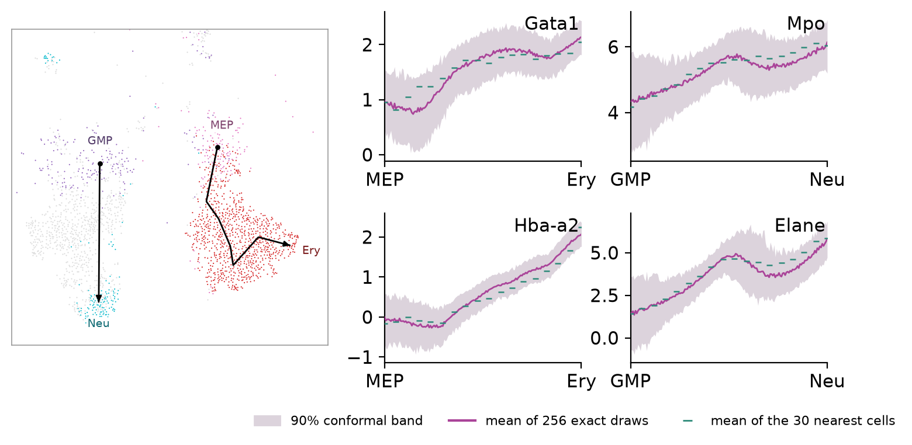
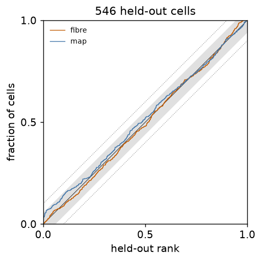
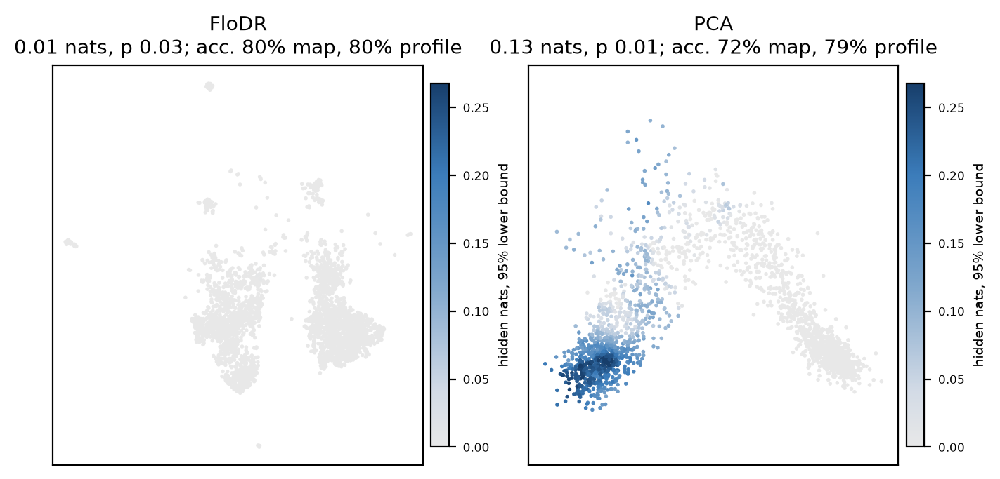

```bash
pip install "flodr[paper]"
python examples/paul15.py
```

[`examples/paul15.py`](https://github.com/daenuprobst/flodr/blob/main/examples/paul15.py) fits FloDR to 2,184 of the
2,730 mouse bone marrow progenitors of Paul et al. (2015), as the 50 principal components of the 1,000 most variable
genes, and keeps the other 546 to calibrate and test. It loads the data through scanpy and takes about a minute and a
half with a GPU.

```
w = 0: recall 0.274, CPD 0.558
w = 2 (default): recall 0.270, CPD 0.795
w = 2, axes="heat": recall 0.271, CPD 0.788
coverage certificate: undecided
FloDR label: level 0.010 nats (1% of what the profile recovers), global p 0.03 (certified), ...
PCA label: level 0.130 nats (11% of what the profile recovers), global p 0.01 (certified), ...
```



The distance order and the heat start ([fitting](../guide/fitting.md)).



Genes decoded along the erythroid and the neutrophil lineage, with conformal bands calibrated on the held-out cells
([density](../guide/density.md#bands-along-the-map)).



The coverage certificate on the held-out cells ([density](../guide/density.md#certificates)).



What the FloDR map and the first two principal components hide about the cell type
([hidden information](../guide/audit.md)).

## The script

```python source
examples/paul15.py
```
