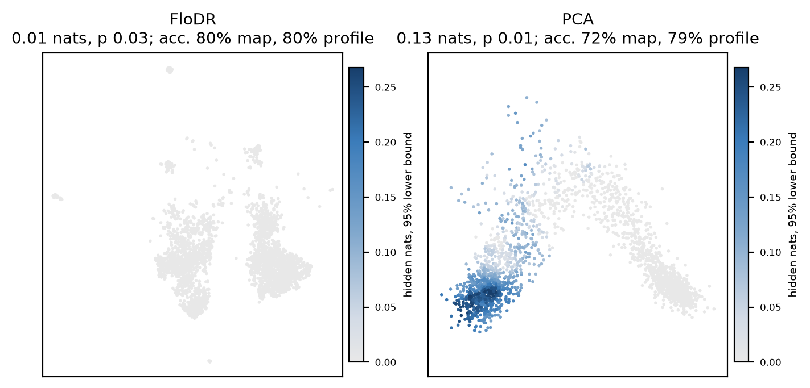

```python
from flodr import audit, plot_audit

res = audit(Y, X=X, labels=labels)    # any 2-D map, FloDR's or not
print(res)                            # level in nats, p-value, accuracies
plot_audit(res)
```

`audit` measures how much the input says about a label beyond what the map position says: it compares a classifier of
the label from the position with one from the input, on held-out points, and tests the gap by permuting labels within
small regions of the map. `res.level` is the hidden information in nats, `res.certified` the verdict of the test
(`test=False` skips it), and `res.field` and `res.lower` its value and lower confidence band per point.

It takes an AnnData object as well: `audit(adata, basis="X_umap", use_rep="X_pca", key="cell_type")` writes the
field and its lower band to `adata.obs["hidden_cell_type"]` and `adata.obs["hidden_cell_type_lower"]`. It runs on the CPU (`n_threads=4`).



The hidden information about cell type on two maps of the same 2,184 [paul15](../examples/paul15.md) cells, coloured
by its 95% lower bound on one scale. The FloDR map hides 0.01 nats. The first two principal components hide 0.13,
where the myeloid types overlap: the lower bound is above zero at 49% of positions.
