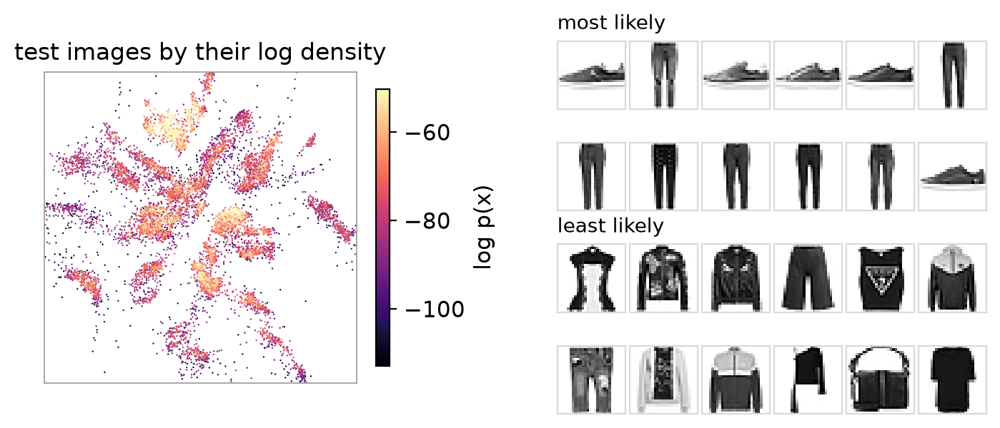
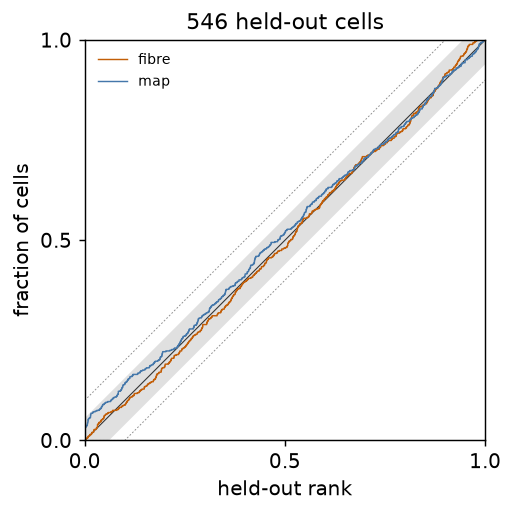
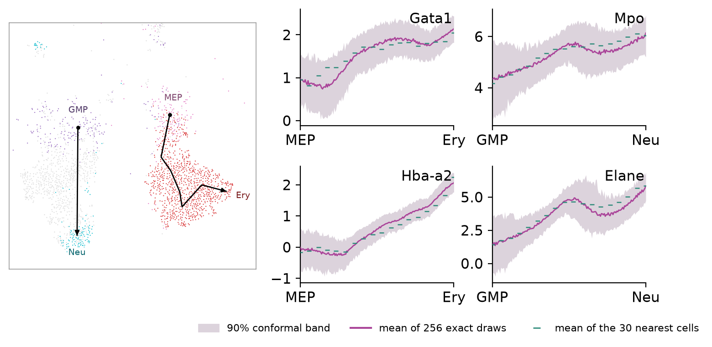

```python
logp = model.score_samples(X)               # log p(x), per point
model.score(X)                              # the mean, for GridSearchCV
```

The density is fitted after the layout, under a small input noise. Its values are worth reading only where it is a
law of the data, so test it on points the model has not seen.



The 10,000 Fashion-MNIST test images coloured by `score_samples`, with the 12 most and the 12 least likely. Trousers
and sneakers are the most likely, dark or patterned tops and jackets the least.

## Certificates

```python
cert = model.coverage_certificate(X_test)
cert["certifies"]                           # "certified", "refused" or "undecided"
energy = model.energy_certificate(X_test)
scale = model.faithful_scale(X_test)
```

`coverage_certificate` ranks each held-out point among exact draws of the density at its own position (`fibre`) and
among draws of positions (`map`). Both ranks are uniform when the density is right; the verdict is an equivalence test
at `margin=0.1`. Without `X` it refits the density on half the training points and tests it on the other half.
`cert["flagged"]` lists the map regions where coverage falls short. `viz.plot_ranks` draws the ranks.



The coverage certificate on 546 held-out [paul15](../examples/paul15.md) cells. Both rank curves stay within the
margin (dotted), but at 546 cells the confidence band (grey, about 0.06 either side) reaches past it, so the verdict
is `undecided`; more held-out cells narrow the band.

`energy_certificate` ranks held-out points by their input distance to the draws at their position, which also
catches draws that are too wide. `faithful_scale` reports, per point, how far the decode stays near-linear at the
density's input noise (`rho`, `hstar`).

## Bands along the map

```python
from flodr.conformal import conformal_bands

bands = conformal_bands(model, X_calib, Y_path, readout=W)  # lo, hi per position
```

The bands hold the inputs at each position at level `1 - alpha` (0.9 by default), calibrated split-conformally on
held-out points `X_calib`. `readout` maps inputs to what you want to read, a matrix (e.g. PCA loadings back to genes)
or a function. `viz.plot_band` draws them along a path.



Four genes decoded along the erythroid and the neutrophil lineage of [paul15](../examples/paul15.md): the 90%
conformal band, the mean of 256 exact draws from p(x | y) and the mean of the 30 nearest cells. Gata1 and Hba-a2 rise
towards the erythrocytes, Mpo and Elane towards the neutrophils.
