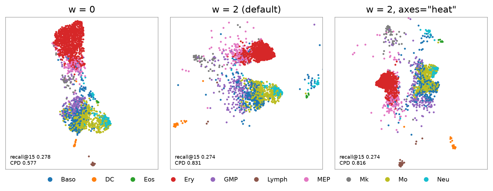

```python
model = FloDR(n_components=2, w=2.0, axes="hinge", density=True, random_state=0).fit(X)
```

`X` is an array or DataFrame, one row per point. FloDR whitens it with PCA (an exact bijection), builds UMAP's graph
of the 15 nearest neighbours and trains the flow so that the first coordinates keep those neighbours, each edge set
against random negatives of its ends, and the order of distances between points, weighted by `w`. With
`density=True` the density of the residual is fitted after the layout.



2,184 bone marrow cells ([paul15](../examples/paul15.md)) fitted with `w=0`, the default and `axes="heat"`. At the
same recall@15 (0.27) the distance order lifts CPD, the rank correlation of input and map distances, from 0.58 to
0.83.

## Parameters

| Parameter | Default | |
|---|---|---|
| `n_components` | `2` | dimension of the map |
| `w` | `2.0` | weight of the distance order; 0 keeps neighbourhoods only, larger values keep more global structure |
| `axes` | `"hinge"` | start from the plane that best keeps the input's distance order, fitted once with a fixed seed, so every seed starts alike; `"variance"` starts from the leading principal components, which are arbitrary on a whitened input; `"heat"` starts from the heat geometry of the neighbour graph, which follows branches rather than variance |
| `density` | `True` | fit the density, needed by `score_samples` and the certificates |
| `max_iter` | `None` | training steps, 6,400 by default; the step size scales with it |
| `fast` | `False` | a quarter of the steps on two of the four coupling layers, see [Fast fits](#fast-fits) |
| `random_state` | `0` | seed; `None` draws one |
| `device` | `None` | the GPU when PyTorch sees one, else the CPU |
| `verbose` | `True` | progress bar |
| `advanced` | `None` | dict of [`TrainConfig`](../api/training.md) overrides, e.g. `{"pad": 0}` |

## Inputs

Pass the representation in which distances should be read, as for UMAP: for single-cell data, 50 standardised
principal components or an integrated latent such as scVI, unscaled. Binary inputs (fingerprints) use Jaccard
distances. Inputs with fewer than 30 columns are padded with noise columns to 30; new points get zeros there.
Reduce inputs with thousands of columns first.

## Fast fits

`fast=True` runs 1,600 steps instead of 6,400 on two of the four coupling layers, at four times the learning rate.
On an RTX 4070 Ti, 100,000 cells of a zebrafish atlas take 40 s instead of 169 s and a million cells 128 s instead
of 612 s; 5,000 MNIST digits take 21 s instead of 54 s, at a recall@15 of 0.430 instead of 0.431 and a CPD of 0.640
instead of 0.636. On large data it keeps fewer neighbours: on the 103,228 cells of the human fetal bone marrow atlas,
a recall@15 of 0.168 instead of 0.187 at a CPD of 0.814 instead of 0.836. The flow stays an exact bijection.
`transform` places new points less precisely on some inputs: of a new MNIST digit's 15 nearest fitted digits, 7 %
instead of 14 % are also its nearest on the map (bone marrow: 7.0 % instead of 7.6 %). `max_iter` and `advanced`
still override the two settings.

## Density preservation

`advanced={"w_dens": 2.0}` adds the density term of densMAP: each point's mean distance to its neighbours on the map
follows the same quantity in the input, so dense populations stay compact and diffuse ones spread out. It is off by
default because it trades local structure for density. On the human fetal bone marrow atlas at weight 2 the
correlation of input and map radii rises from 0.77 to 0.90 and recall@15 falls from 0.186 to 0.136; 0.5 is a milder
setting (0.88 and 0.156).

## Reproducibility

On the CPU a seed reproduces a fit exactly. On CUDA the compiled half-precision training step is about twice as fast
but not bitwise reproducible; `advanced={"compile_edges": False, "half_edges": ""}` runs it eagerly in full precision.
If a CUDA fit returns non-finite coordinates (it warns), refit.
