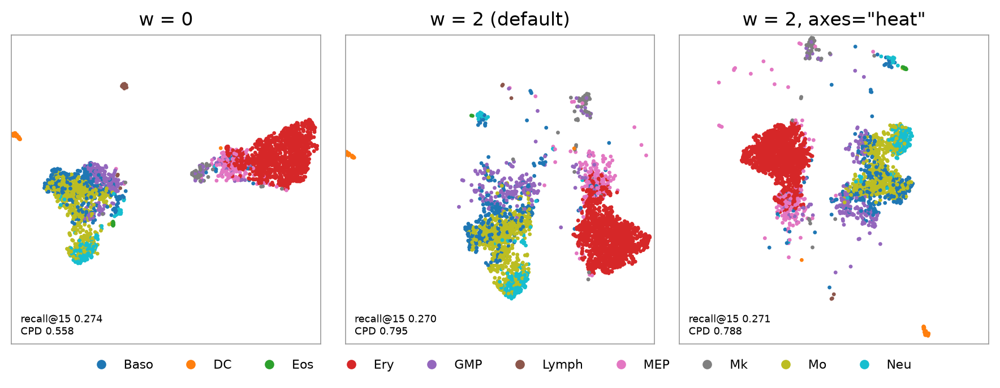

```python
model = FloDR(n_components=2, w=2.0, axes="variance", density=True, random_state=0).fit(X)
```

`X` is an array or DataFrame, one row per point. FloDR whitens it with PCA (an exact bijection), builds the graph of
the 15 nearest neighbours and trains the flow so that the first coordinates keep those neighbours, as in UMAP, and
the order of distances between points, weighted by `w`. With `density=True` the density of the residual is fitted
after the layout.



2,184 bone marrow cells ([paul15](../examples/paul15.md)) fitted with `w=0`, the default and `axes="heat"`. At the
same recall@15 (0.27) the distance order lifts CPD, the rank correlation of input and map distances, from 0.56 to
0.80.

## Parameters

| Parameter | Default | |
|---|---|---|
| `n_components` | `2` | dimension of the map |
| `w` | `2.0` | weight of the distance order; 0 keeps neighbourhoods only, larger values keep more global structure |
| `axes` | `"variance"` | start from the leading principal components; `"heat"` starts from the heat geometry of the neighbour graph, which follows branches rather than variance |
| `density` | `True` | fit the density, needed by `score_samples` and the certificates |
| `max_iter` | `None` | training steps, 6,400 by default; the step size scales with it |
| `random_state` | `0` | seed; `None` draws one |
| `device` | `None` | the GPU when PyTorch sees one, else the CPU |
| `verbose` | `True` | progress bar |
| `advanced` | `None` | dict of [`TrainConfig`](../api/training.md) overrides, e.g. `{"pad": 0}` |

## Inputs

Pass the representation in which distances should be read, as for UMAP: for single-cell data, 50 standardised
principal components or an integrated latent such as scVI, unscaled. Binary inputs (fingerprints) use Jaccard
distances. Inputs with fewer than 30 columns are padded with noise columns to 30; new points get zeros there.
Reduce inputs with thousands of columns first.

## Reproducibility

On the CPU a seed reproduces a fit exactly. On CUDA the compiled half-precision training step is about twice as fast
but not bitwise reproducible; `advanced={"compile_edges": False, "half_edges": ""}` runs it eagerly in full precision.
If a CUDA fit returns non-finite coordinates (it warns), refit.
