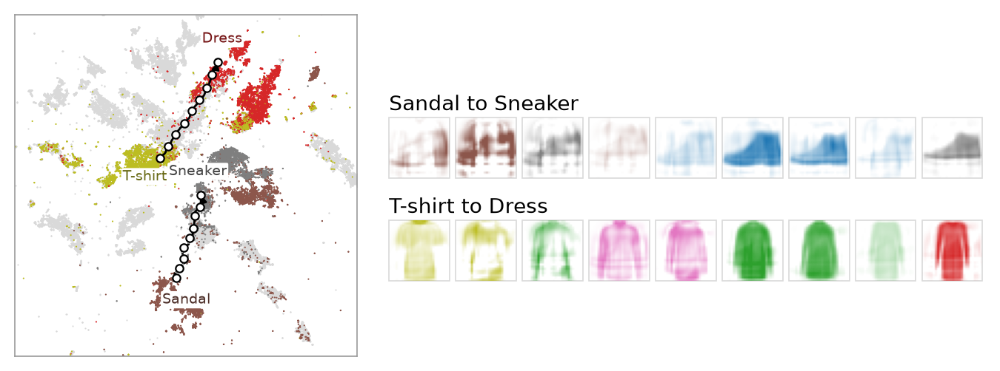

```python
Z = model.transform_latent(X)       # (n, d): the map, then the residual
X_same = model.inverse_latent(Z)    # exact up to float precision
X_rep = model.inverse_transform(Y)  # positions only, residual set to zero
```

Every layer of the flow is an affine coupling, so the map is a bijection and `inverse_latent` undoes
`transform_latent` exactly. `inverse_transform` decodes a position with the residual set to zero, one input per
position; the zero of the residual has no meaning of its own.

To decode what the points at a position look like, borrow the residual of the training points nearest it on the map:

```python
from scipy.spatial import cKDTree

Z_train = model.transform_latent(X_train)
nn = cKDTree(Z_train[:, :2]).query(Y_query, k=15)[1]
Z = Z_train[nn].mean(1)
Z[:, :2] = Y_query
X_decoded = model.inverse_latent(Z)
```



Two walks across the [Fashion-MNIST](../examples/fashion-mnist.md) map, each the shortest path through the graph of
15 nearest neighbours on the map between the densest points of two classes, decoded at nine steps with the borrowed
residual. Where no training image is near (dashed on the map) the decoded images are faded: there the map has
nothing to decode from.

Many inputs share a position. With the density, `flodr.conformal.sample_fibre(model, Y, n_draws=64)` draws them
exactly from p(x | y), and `flodr.conformal.conformal_bands(model, X_calib, Y)` gives split-conformal bands of the
inputs at each position, calibrated on held-out points (see [Density](density.md)).
