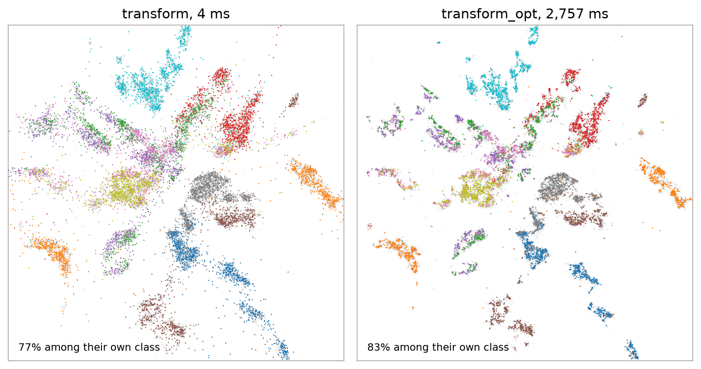

```python
Y_new = model.transform(X_new)        # one forward pass, milliseconds
Y_opt = model.transform_opt(X_new)    # optimised against the training map
```

`transform` places points where the flow maps them. `transform_opt` starts there and moves each point towards the map
positions of its 15 nearest training points in the input, the same kind of placement as UMAP's `transform`. It
keeps more neighbours and costs more time (`steps=200`, `lr=0.05`).



The 10,000 [Fashion-MNIST](../examples/fashion-mnist.md) test images placed by `transform` (4 ms on a GPU) and by
`transform_opt` (2.8 s), over the 60,000 training images (grey). For 77% and 83% of them most of their 15 nearest
training images on the map are of their own class.

On padded inputs (fewer than 30 columns) the training points carry noise in the padding and new points do not, so
`transform(X_train)` lands near `embedding_`, not on it.
