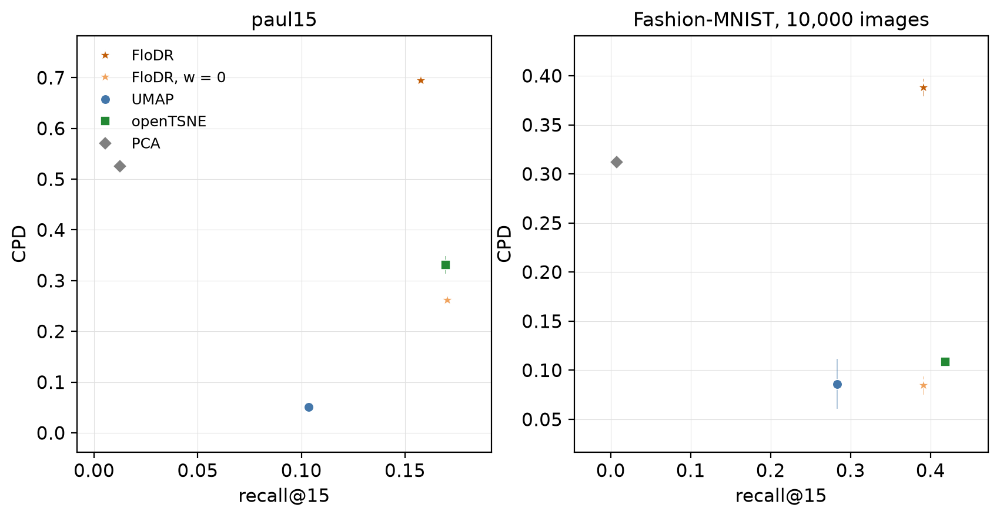

`flodr.viz` draws the plots of the FloDR paper. Every function takes an `ax` (one is created when it is `None`) and
returns it; maps are square boxes at 1:1 data scale.

```python
from flodr import viz

viz.plot_embedding(Y, labels)                              # a map coloured by label
viz.plot_embedding(Y, values=depth, cmap="magma")          # or by a value per point
viz.plot_frontier({"FloDR": (recalls, cpds), "UMAP": (r2, c2)})  # local against global
viz.plot_ranks([cert["fibre"]["ranks"], cert["map"]["ranks"]])   # a certificate
viz.plot_paths(Y, [path], labels=labels)                   # paths over the map
viz.plot_band(bands["lo"][:, g], bands["hi"][:, g], mean)  # a value decoded along a path
viz.plot_audit(res)                                        # hidden information
viz.save(fig, "figure.pdf")
```

`viz.RC` is a matplotlib style for screen figures: `plt.rcParams.update(viz.RC)`.



`plot_frontier` in the [benchmark](../examples/benchmark.md). The figures in these pages come from the examples,
which use `flodr.viz` throughout.
