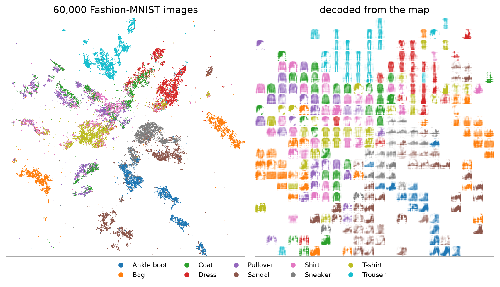

FloDR is a dimensionality reduction method built on an invertible normalising flow. The first `n_components`
coordinates of the flow are the map and the rest are a residual, so the fitted map has an exact inverse and an exact
density. It follows the scikit-learn estimator interface, like UMAP.



60,000 Fashion-MNIST images on the map (left), and the map decoded back to images on a grid over it (right). The
[examples](examples/fashion-mnist.md) show more.

```python
from flodr import FloDR

model = FloDR(random_state=0).fit(X)
Y = model.embedding_
```

| | |
|---|---|
| `fit`, `fit_transform` | the map of the training points |
| `transform`, `transform_opt` | place new points |
| `inverse_transform`, `inverse_latent` | decode positions and latents back to the input |
| `score_samples` | the log density of points |
| `coverage_certificate`, `energy_certificate` | test the density on held-out points |
| `flodr.audit` | what the map hides about a label |
| `flodr.viz` | the plots of the paper |

Start with [Installation](installation.md) and the [Quickstart](quickstart.md).
